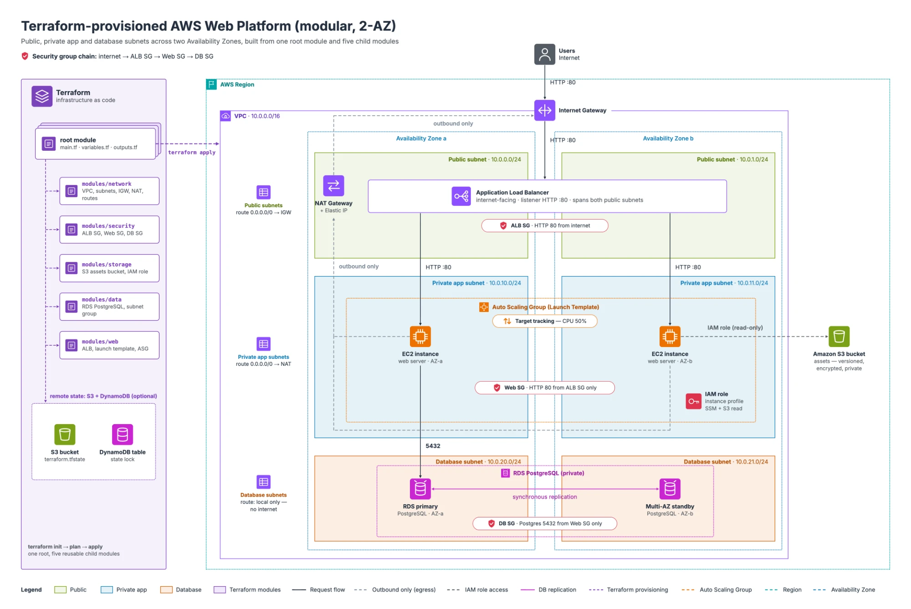

# terraform-aws-web-platform

A modular, two-AZ AWS web platform built with Terraform: an Application Load Balancer and EC2 Auto Scaling web tier, a private RDS PostgreSQL database, an S3 bucket with an IAM instance role, and CPU-based auto scaling.



```
Users → Internet Gateway → Application Load Balancer (public subnets)
            → EC2 Auto Scaling Group (private subnets)   [scales on CPU]
                 → RDS PostgreSQL (database subnets, private)
                 → S3 bucket (via IAM instance role)
            → outbound via NAT Gateway
```

## Modules
- `modules/network` — VPC, public / private app / database subnets, IGW, NAT, route tables
- `modules/security` — ALB, web, and database security groups
- `modules/storage` — S3 bucket (versioned, encrypted) + IAM instance role
- `modules/data` — RDS PostgreSQL + DB subnet group
- `modules/web` — launch template, ALB, target group, listener, Auto Scaling Group, scaling policy

## Run
```bash
terraform init
terraform fmt -recursive
terraform validate
terraform plan
terraform apply
```
Open the `alb_dns_name` output in a browser. Tear down with `terraform destroy`.

- Dev values auto-load from `terraform.tfvars`. For prod: `terraform apply -var-file="prod.tfvars"`.
- Supply the database password with `export TF_VAR_db_password='...'`; never commit real secrets.
- `backend.tf.example` shows optional S3 + DynamoDB remote state.

## Notes
Needs AWS credentials (`aws configure`) and Terraform >= 1.6. The NAT gateway, ALB, and RDS cost money hourly — run `terraform destroy` when done.
